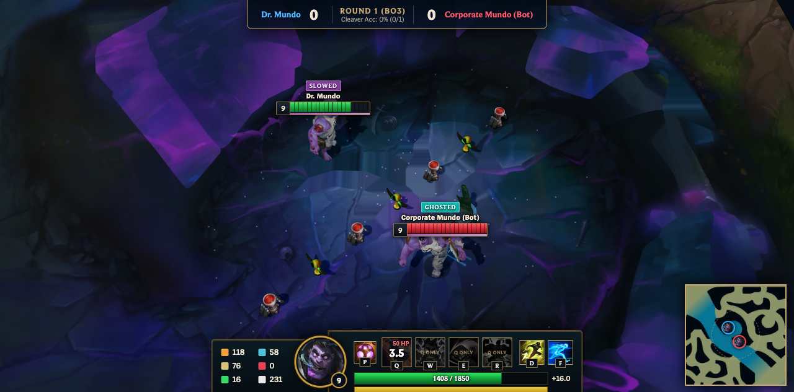

# Baron Pit 1v1 (Dr. Mundo & Cho'Gath)

Skip the queue, pick your champion, and battle 1v1 in the Baron Pit right from your browser—play Dr. Mundo (*Infected Bonesaw*) or Cho'Gath (*Rupture*) against friends or the AI bot.



## Stack

- **Frontend:** TypeScript, Three.js (3D graphics & animations), HTML/CSS
- **Backend:** Node.js, Express, WebSockets (`ws`) for real-time 60 Hz authoritative multiplayer
- **Shared Core:** Single-source-of-truth champion configs and protocol types in `src/shared/`

## Commands

```bash
npm install
npm run typecheck   # Typecheck shared, server, and client
npm run build       # Build server (dist/) and browser client (public/build/)
npm test            # Build + run registry, simulation, and live WebSocket E2E tests
npm start           # Build and run server on http://localhost:3000
```

## Extending with New Champions

See [docs/ADDING_CHAMPIONS.md](docs/ADDING_CHAMPIONS.md) for the config-driven champion workflow.
